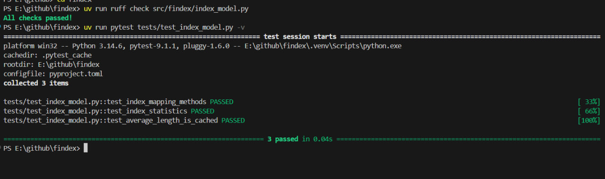
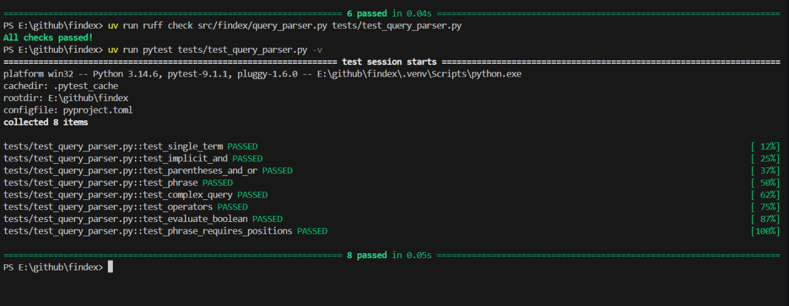
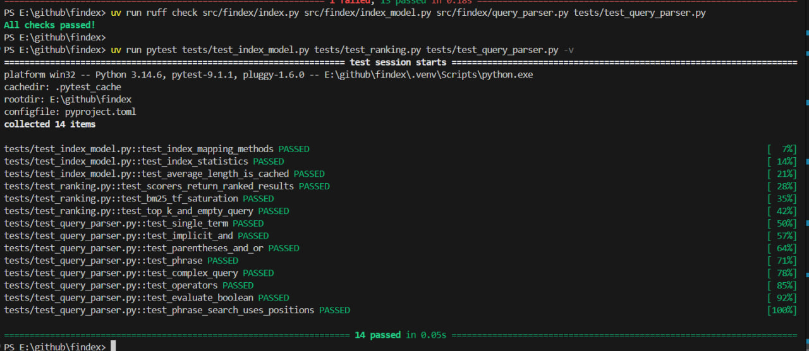
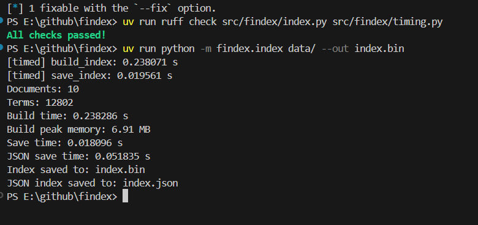
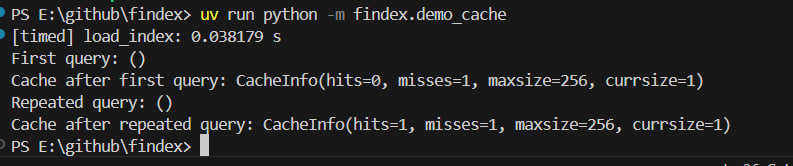
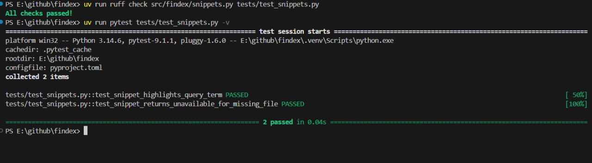
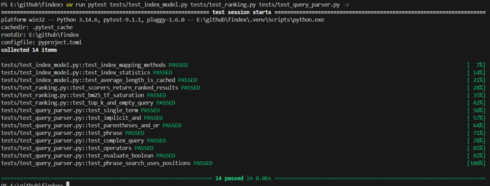
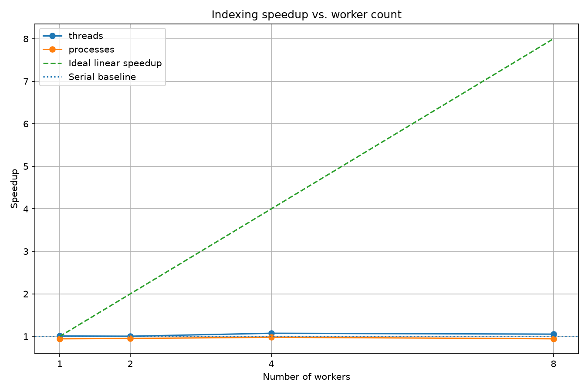

# Лабораторна робота №1. Ітератори, генератори та потокова обробка текстових даних

## 1. Опис проєкту

Навчальний проєкт пошукової системи для текстового корпусу.

Проєкт розроблено в межах лабораторної роботи №1 з Python на тему ітераторів, генераторів та потокової обробки текстових даних.

## 2. Мета лабораторної роботи

Мета лабораторної роботи — дослідити ітератори та генератори Python, реалізувати ліниву (lazy) обробку текстового корпусу та порівняти її з eager-підходом, який завантажує всі дані в пам'ять.

## 3. Структура проєкту

```text
findex/
├── data/                  # локальний текстовий корпус
├── src/
│   └── findex/
│       ├── __init__.py
│       ├── corpus.py      # читання документів
│       ├── tokenize.py   # токенізація тексту
│       └── stats.py      # обчислення статистики
├── tests/
│   └── test_tokenize.py  # тести токенізатора
├── pyproject.toml
├── README.md
└── uv.lock
```

## 4. Текстовий корпус

Корпус складається з 10 текстових документів у форматі `.txt`. Приблизно половина документів була підготовлена на основі текстових матеріалів Wikipedia, а інша половина — на основі електронної книги Германа Мелвілла *Moby Dick; Or, The Whale* з Project Gutenberg.

Джерело книги:

[https://www.gutenberg.org/ebooks/2701](https://www.gutenberg.org/ebooks/2701)

Корпус зберігається локально в директорії `data/`. Директорія `data/` додана до `.gitignore`, тому текстові файли корпусу не зберігаються в Git-репозиторії.

## 5. M1 — Потокове читання документів

У файлі `corpus.py` реалізовано генератор `iter_documents()`.

Він:

- знаходить `.txt` файли за допомогою `Path.rglob()`;
- відкриває документи по одному;
- читає текст у кодуванні UTF-8;
- використовує `errors="replace"` для обробки можливих помилок кодування;
- повертає об'єкти `Document`;
- використовує `yield`, тому всі документи не завантажуються одночасно.

### Структура документа

- `doc_id`
- `path`
- `text`

## 6. M2 — Токенізація

У файлі `tokenize.py` реалізовано генератор `tokenize()`.

Перед токенізацією виконується:

- Unicode-нормалізація NFC;
- приведення тексту до регістру за допомогою `casefold()`;
- пошук слів за допомогою `re.finditer()`.

### Правила токенізації

- Літери входять до токена.
- Великі та малі літери нормалізуються через `casefold()`.
- Апострофи всередині слів зберігаються.
- Дефіс розділяє слова.
- Цифри не входять до токенів.
- Пунктуація ігнорується.

### Приклад токенізації

Вхідний текст:

```text
КІБЕР-БЕЗПЕКА та комп'ютер
```

Результат:

```text
кібер
безпека
та
комп'ютер
```

Для токенізатора створено автоматичні тести, які перевіряють регістр, кирилицю, апострофи, дефіси, пунктуацію, цифри, порожній рядок та Unicode-нормалізацію.

## 7. M3 — Статистика корпусу

У файлі `stats.py` реалізовано потоковий підрахунок:

- кількості документів;
- загальної кількості токенів;
- розміру словника;
- 50 найчастіших токенів;
- часу виконання;
- пікового використання пам'яті.

Для вимірювання часу використовується `time.perf_counter()`, а для вимірювання пам'яті — `tracemalloc`.

Також реалізовано параметр:

```text
--limit N
```

який дозволяє обробити тільки перші N документів.

Для обмеження потоку документів використовується `itertools.islice()`.

### Результат для повного корпусу

| Показник | Результат |
|---|---:|
| Documents | 10 |
| Tokens | 44008 |
| Vocabulary | 12802 |
| Elapsed time | 0.1030 seconds |
| Peak memory | 1.79 MB |

## 8. M4 — Lazy та Eager обробка

Для порівняння було реалізовано два підходи.

### Lazy

Lazy-версія використовує генератори та обробляє документи поступово:

```text
документ → токенізація → підрахунок → наступний документ
```

Документи та токени не зберігаються всі одночасно в пам'яті.

### Eager

Eager-версія спочатку завантажує всі документи в список, а потім створює списки токенів для всіх документів.

Таким чином, більша кількість даних одночасно зберігається в пам'яті.

### Порівняння

| Version | Documents | Tokens | Vocabulary | Elapsed time | Peak memory |
|---|---:|---:|---:|---:|---:|
| Lazy | 10 | 44008 | 12802 | 0.1030 s | 1.79 MB |
| Eager | 10 | 44008 | 12802 | 0.0943 s | 4.47 MB |

Обидві реалізації дали однакові результати за кількістю документів, токенів та унікальних слів.

Eager-версія використала більше пам'яті, оскільки зберігає всі документи та токени в пам'яті. Lazy-версія використовує генератори та обробляє дані поступово, тому її пікове використання пам'яті нижче.

На цьому невеликому корпусі Eager-версія виявилася трохи швидшою, однак різниця в часі невелика. Основна перевага Lazy-підходу проявляється у зменшенні використання пам'яті, особливо зі збільшенням розміру корпусу.

## 9. Запуск програми

Усі команди виконуються з кореневої папки проєкту `findex`.

### 9.1. Запуск статистики корпусу

```bash
uv run python -m findex.stats data
```

### 9.2. Обробка обмеженої кількості документів

```bash
uv run python -m findex.stats data --limit 2
```

### 9.3. Запуск тестів

```bash
uv run pytest
```

### 9.4. Перевірка стилю коду

```bash
uv run ruff check
```

## 10. Висновок

У лабораторній роботі було реалізовано потокову обробку текстового корпусу за допомогою ітераторів та генераторів Python. Було створено генератор `iter_documents()` для послідовного читання документів та генератор `tokenize()` для лінивої токенізації тексту. Також було реалізовано підрахунок статистики корпусу та проведено експериментальне порівняння lazy- та eager-підходів. Результати експерименту показали, що lazy-обробка потребує менше пам'яті, оскільки дані обробляються поступово, без зберігання всього корпусу та всіх токенів у пам'яті.


# Лабораторна робота №2. Інвертований індекс: словники, хешування та пам'ять

## Мета роботи

Метою роботи є розроблення інвертованого індексу для пошуку документів, дослідження внутрішнього устрою словників і множин Python, особливостей хешування об'єктів, використання `collections`, `dataclasses`, `__slots__` і компактних структур даних. Також необхідно реалізувати булевий пошук, збереження та завантаження індексу, а також порівняти час виконання операцій і використання пам'яті.

---

## 1. Теоретичні відомості

### 1.1. Внутрішній устрій `dict` і `set`

Словник `dict` у Python зберігає пари «ключ — значення» та використовує хеш-таблицю для швидкого доступу до елементів. Для пошуку ключа обчислюється його хеш за допомогою `hash()`, після чого Python визначає позицію в таблиці.

У середньому пошук, додавання та видалення елементів у словнику мають складність \(O(1)\). У разі великої кількості колізій час виконання може збільшуватися.

Колізія виникає тоді, коли різні ключі мають однаковий хеш або потрапляють до однієї початкової позиції таблиці. CPython використовує відкрите адресування для пошуку іншої позиції, якщо початкова зайнята.

Словники Python зберігають порядок додавання елементів. Множина `set` також використовує хеш-таблицю, але зберігає лише унікальні елементи без відповідних значень.

### 1.2. Контракт `__hash__` і `__eq__`

Метод `__hash__()` повертає хеш об'єкта, а `__eq__()` визначає, чи вважаються два об'єкти рівними.

Для коректної роботи ключів у словниках і множинах необхідно дотримуватися правила:

**Якщо два об'єкти рівні (`a == b`), їхні хеші мають бути однаковими (`hash(a) == hash(b)`).**

Протилежне твердження не є обов'язковим: різні об'єкти можуть мати однакові хеші.

Змінювані типи, наприклад `list`, `dict` і `set`, зазвичай не є хешованими, оскільки зміна їхнього вмісту могла б порушити коректність хеш-таблиці. Незмінні типи, наприклад `str`, `int` і `tuple` із хешованими елементами, можуть бути ключами словника.

Якщо клас визначає власний `__eq__()`, але не визначає узгоджений `__hash__()`, Python зазвичай робить його екземпляри нехешованими.

У цій лабораторній роботі `Posting` і `DocMeta` оголошені через `@dataclass(frozen=True, slots=True)`. Незмінність об'єктів дає змогу безпечно використовувати автоматично згенерований хеш, якщо всі поля також хешовані.

### 1.3. Використання `collections`

У програмі застосовано такі структури:

- `defaultdict(list)` автоматично створює порожній список для нового терміна, що спрощує накопичення постінгів.
- `Counter` підраховує кількість входжень кожного терміна в документі.
- `dict` зберігає інвертований індекс і метадані документів.
- `set` використовується для альтернативної реалізації булевих операцій.

### 1.4. Dataclasses і `__slots__`

Декоратор `@dataclass` автоматично створює типові методи класу, зокрема ініціалізацію та порівняння об'єктів.

Параметр `frozen=True` забороняє змінювати поля екземпляра після створення. Параметр `slots=True` створює слоти для оголошених атрибутів і зменшує накладні витрати пам'яті порівняно зі звичайним зберіганням атрибутів через `__dict__`.

Це важливо для індексу, який може містити велику кількість об'єктів `Posting`.

### 1.5. Компактне зберігання через `array`

Звичайні списки Python зберігають посилання на об'єкти, а цілі числа є окремими об'єктами Python. Це створює додаткові витрати пам'яті.

Модуль `array` дає змогу зберігати числові значення в компактному типізованому масиві. Зокрема, `array('I')` використовує беззнакові цілі числа типу C `unsigned int`; фактичний розмір елемента можна перевірити через `itemsize`.

У лабораторній роботі цей формат використано для зберігання пар `doc_id` і `tf`.

---

## 2. Побудова інвертованого індексу (M1)

Інвертований індекс — це структура даних, яка зіставляє кожен термін зі списком документів, у яких цей термін зустрічається.

Для кожного терміна зберігаються постінги — пари, що містять ідентифікатор документа (`doc_id`) і частоту терміна в ньому (`tf`).

Для побудови індексу використано:

- `defaultdict(list)` для накопичення постінгів;
- `Counter` для підрахунку частоти термінів у документі;
- `Posting` для представлення постінгу;
- `DocMeta` для зберігання метаданих документа;
- `@dataclass(frozen=True, slots=True)` для незмінних об'єктів із меншими накладними витратами пам'яті.

Індекс будується на основі лінивого пайплайну обробки документів із лабораторної роботи 1. Документи обробляються послідовно, без необхідності одночасно завантажувати весь корпус у пам'ять. Для кожного документа підраховуються терміни, після чого відповідні постінги додаються до індексу.

Після побудови списки постінгів сортуються за `doc_id`. Довжина документа та його метадані зберігаються для подальшого показу результатів пошуку.

Позиції термінів у документах у цій реалізації не зберігаються.

---

## 3. Булевий пошук (M2)

Реалізовано пошук за термінами з підтримкою таких операцій:

- **AND** — повертає документи, у яких присутні всі задані терміни.
- **OR** — повертає документи, у яких присутній хоча б один заданий термін.
- **NOT** — повертає документи, у яких відсутній заданий термін.

Якщо в запиті вказано два терміни без явного оператора, наприклад `розділ the`, використовується операція AND.

Для пошуку реалізовано два алгоритми.

### Merge

Алгоритм двох покажчиків працює з відсортованими списками `doc_id`. Для AND покажчики порівнюють поточні ідентифікатори: якщо вони однакові, документ додається до результату; інакше пересувається покажчик меншого значення. Для відсортованих списків довжини \(n\) і \(m\) складність перетину становить \(O(n+m)\).

### Set

Ідентифікатори документів перетворюються на множини, після чого застосовуються операції перетину, об'єднання або різниці. Такий підхід зручний, але створення множин потребує додаткової пам'яті.

Алгоритм вибирається параметром `--engine {merge,set}`.

### 3.1. Порівняння merge та set

Для порівняння використано два найчастотніші та два найрідкісніші терміни корпусу.

| Термін | Частота | Merge, с | Set, с |
|---|---:|---:|---:|
| і | 812 | 0.000020 | 0.000040 |
| що | 738 | 0.000028 | 0.000029 |
| біографічний | 1 | 0.000017 | 0.000034 |
| карти | 1 | 0.000020 | 0.000020 |

*Примітка:* вимірювання мають орієнтовний характер. Оскільки операції виконуються за дуже короткий час, результати можуть змінюватися через похибку вимірювання та особливості середовища виконання.

За отриманими результатами `merge` був швидшим для частини перевірених термінів. В інших випадках різниця була незначною. Тому за цими вимірюваннями не можна зробити висновок, що один алгоритм завжди швидший за інший.

---

## 4. Збереження та завантаження індексу (M3)

Для повторного використання індексу без необхідності перебудовувати його під час кожного пошуку реалізовано збереження та завантаження у двох форматах:

- **Pickle** — бінарний формат серіалізації об'єктів Python.
- **JSON** — текстовий формат збереження структурованих даних.

### 4.1. Порівняння форматів

| Формат | Файл | Розмір, байт | Час збереження, с | Час завантаження, с |
|---|---|---:|---:|---:|
| Pickle | `index.bin` | 392905 | 0.008621 | 0.074755 |
| JSON | `index.json` | 427347 | 0.050539 | 0.029283 |

За результатами вимірювань файл Pickle має менший розмір і швидше зберігається. У цьому запуску JSON завантажувався швидше. Результати залежать від середовища виконання, розміру корпусу та реалізації серіалізації.

### 4.2. Безпека Pickle

Завантаження Pickle-файлів із ненадійних джерел небезпечне, оскільки десеріалізація може виконати довільний код. Тому `pickle.load()` слід використовувати лише для файлів, походження яких відоме та яким можна довіряти.

JSON не має такого самого механізму виконання довільного коду під час стандартного розбору даних, тому підходить для обміну структурованими даними, але вимагає явного перетворення об'єктів у JSON-сумісні типи та назад.

---

## 5. Дослідження використання пам'яті (M4)

## Дослідження використання пам'яті (M4)

Для оцінювання використання пам'яті застосовано модуль `tracemalloc`. Порівнювалися три варіанти представлення постінгів:

1. Звичайний `dataclass`.
2. `dataclass` із `slots=True`.
3. Компактний `array('I')`, що зберігає пари `doc_id` і `tf`.

Для кожного представлення вимірювали пікове використання пам'яті під час побудови, розмір серіалізованого файлу та час завантаження з файлу. Для серіалізації використовувався `pickle` з протоколом `pickle.HIGHEST_PROTOCOL`.

### 5.1. Результати вимірювання

| Представлення постінгів | Пікова пам'ять під час побудови | Розмір файлу індексу | Час завантаження |
|---|---:|---:|---:|
| `list[Posting]`, звичайний `dataclass` | 1.69 MB | 323.57 KB | 0.026476 с |
| `list[Posting]`, `slots=True` | 0.99 MB | 377.47 KB | 0.021041 с |
| Пари `array('I')` | 1.55 MB | 579.09 KB | 0.021610 с |

### 5.2. Аналіз результатів

Звичайний `dataclass` використовує 1.69 MB пікової пам'яті під час побудови представлення. Розмір серіалізованого файлу становить 323.57 KB, а час завантаження — 0.026476 с.

Використання `slots=True` зменшило пікове використання пам'яті до 0.99 MB. Це найменше значення серед трьох досліджених варіантів. Розмір файлу становить 377.47 KB, а час завантаження — 0.021041 с, що є найкращим результатом серед трьох варіантів у цьому вимірюванні.

`array('I')` зберігає числові значення у компактному форматі масиву. У проведеному експерименті пікове використання пам'яті становило 1.55 MB, розмір файлу — 579.09 KB, а час завантаження — 0.021610 с.

Отже, за результатами вимірювання `dataclass` із `slots=True` забезпечив найменше пікове використання пам'яті та найкоротший час завантаження. Звичайний `dataclass` дав найменший розмір серіалізованого файлу. Результати стосуються конкретного корпусу документів і серіалізації через `pickle`; для інших корпусів та обсягів даних показники можуть відрізнятися.

## 6. Запуск програми

Усі команди виконуються з кореневої папки репозиторію `findex`.

### 6.1. Побудова та збереження індексу

```bash
uv run python -m findex.index data/ --out index.bin
```

Команда обробляє корпус, будує інвертований індекс і зберігає його. Програма також виводить показники виконання, зокрема кількість документів і термінів, час побудови, пікове використання пам'яті та час збереження.

### 6.2. Пошук у збереженому індексі

```bash
uv run python -m findex.search index.bin "розділ"
```

Команда завантажує збережений індекс, виконує пошук і виводить знайдені документи та показники часу виконання.

### 6.3. Вибір алгоритму пошуку

Алгоритм `merge`:

```bash
uv run python -m findex.search index.bin "розділ" --engine merge
```

Алгоритм `set`:

```bash
uv run python -m findex.search index.bin "розділ" --engine set
```

### 6.4. Булеві операції

**AND:**

```bash
uv run python -m findex.search index.bin "розділ the" --operation AND
```

**OR:**

```bash
uv run python -m findex.search index.bin "розділ the" --operation OR
```

**NOT:**

```bash
uv run python -m findex.search index.bin "розділ" --operation NOT
```

### 6.5. Вимірювання пам'яті

```bash
uv run python -m findex.memory
```

Команда порівнює пікове використання пам'яті трьома способами зберігання постінгів.

---

## 7. Питання для підготовки до захисту (Reflection)

### 1. Як працює хеш-таблиця та що таке колізія?

Хеш-таблиця використовує хеш ключа для визначення початкової позиції. Якщо кілька ключів претендують на одну позицію, виникає колізія. CPython використовує відкрите адресування для пошуку іншої позиції. Під час пошуку Python перевіряє хеш і рівність ключів.

### 2. Який контракт хешування?

Якщо `a == b`, то обов'язково `hash(a) == hash(b)`. Якщо це правило порушити, словник або множина можуть поводитися некоректно під час пошуку елементів. Різні об'єкти можуть мати однакові хеші.

### 3. Чому список не можна використовувати як ключ словника, а кортеж іноді можна?

Список змінюваний і тому не є хешованим. Кортеж незмінний, але його хешованість залежить від елементів: кортеж із хешованих значень може бути ключем, а кортеж, що містить список, — ні.

### 4. Що змінює `@dataclass(frozen=True)`?

Параметр `frozen=True` забороняє змінювати поля екземпляра після створення та дає змогу згенерувати хеш для відповідного набору хешованих полів. Якщо визначити `__eq__()` вручну без узгодженого `__hash__()`, Python зазвичай робить клас нехешованим.

### 5. Для чого потрібен `slots=True`?

Звичайні екземпляри Python зберігають атрибути у словнику `__dict__`, що створює додаткові витрати пам'яті. `slots=True` використовує заздалегідь оголошені слоти й зменшує ці витрати. Компроміс полягає в тому, що не можна довільно додавати нові атрибути, які не оголошені у слотах.

### 6. Чому `array('I')` може використовувати менше пам'яті?

`array('I')` зберігає цілі числа у компактному типізованому форматі замість окремих об'єктів Python. Проте фактична економія залежить від того, чи враховуються словники, проміжні структури та інші накладні витрати. У цій роботі виміряні результати показали, що найменше пікової пам'яті використав варіант `slots=True`.

### 7. Чим відрізняються merge та set?

Merge проходить відсортовані списки двома покажчиками й не потребує створення множин. Для двох списків довжини \(n\) та \(m\) його складність становить \(O(n+m)\). Set використовує хеш-таблиці, що може бути зручніше в окремих випадках, але потребує додаткової пам'яті. Результати бенчмарку залежать від частоти термінів і конкретних даних.

### 8. Чому `pickle.load()` із ненадійного файлу небезпечний?

Під час десеріалізації Pickle може виконувати довільний код. Тому не можна завантажувати Pickle-файли, отримані з невідомих джерел або через ненадійні канали.

## Рефлексія — підготовка до захисту

### 1. Як працює хеш-таблиця з 8 слотами?

Хеш-таблиця зберігає ключі за індексами, які обчислюються на основі їхнього хешу. Якщо два ключі потрапляють в один слот, виникає колізія.

Для пояснення використаємо спрощений приклад із лінійним пробуванням:

```text
Слоти:  0   1   2   3   4   5   6   7
        -   A   B   C   -   -   -   -
```

Припустимо, ключі `A`, `B` і `C` мають початковий індекс `1`.

1. `A` займає слот 1.
2. `B` перевіряє слот 1, знаходить його зайнятим і потрапляє в слот 2.
3. `C` перевіряє слоти 1 і 2, а потім займає слот 3.

Під час пошуку `B` Python перевіряє послідовність пробування та порівнює знайдені ключі. Коли ключ збігається, повертається його значення.

**Важливо:** CPython використовує не просте лінійне пробування, а алгоритм відкритої адресації з додатковим пробуванням. Тому наведена схема пояснює принцип колізій, а не всі деталі внутрішнього алгоритму.

### 2. Який контракт хешування? Як його порушити?

Основний контракт:

- Якщо `a == b`, то `hash(a) == hash(b)`.
- Однаковий об'єкт має зберігати стабільний хеш протягом часу використання як ключа.
- Різні об'єкти можуть мати однаковий хеш — це колізія, яка сама по собі не є помилкою.

Приклад порушення контракту:

```python
class BadKey:
    def __init__(self, value, custom_hash):
        self.value = value
        self.custom_hash = custom_hash

    def __eq__(self, other):
        if not isinstance(other, BadKey):
            return NotImplemented
        return self.value == other.value

    def __hash__(self):
        return self.custom_hash


a = BadKey("key", 1)
b = BadKey("key", 2)

print(a == b)  # True
print(hash(a))  # 1
print(hash(b))  # 2

data = {a: "значення"}
print(data.get(b))  # None
```

Об'єкти рівні за `__eq__`, але мають різні хеші. Тому словник може не знайти значення за ключем `b`, хоча `a == b`.

### 3. Чому списки нехешуються, а кортежі хешуються?

Список змінюваний: його елементи можна додавати, видаляти й змінювати. Якщо б його хеш змінювався після вставлення в словник, словник міг би втратити доступ до ключа.

Кортеж незмінний, тому може бути хешованим, якщо всі його елементи також хешовані.

```python
print(hash((1, 2)))  # Працює

print(hash([1, 2]))  # TypeError

print(hash((1, [2])))  # TypeError
```

Кортеж `(1, [2])` не хешується, оскільки всередині міститься список, який є нехешованим.

### 4. Як `@dataclass(frozen=True)` впливає на `__hash__`?

`@dataclass(frozen=True)` забороняє звичайну зміну полів екземпляра. Якщо `eq=True` (за замовчуванням) і `unsafe_hash` не задано, `dataclass` зазвичай генерує `__hash__`, якщо це безпечно з погляду налаштувань класу.

```python
from dataclasses import dataclass


@dataclass(frozen=True)
class Point:
    x: int
    y: int


point = Point(1, 2)
print(hash(point))
```

Якщо визначити `__eq__` вручну в звичайному класі, але не визначити `__hash__`, Python зазвичай встановлює `__hash__ = None`. Такий екземпляр стає нехешованим.

```python
class Point:
    def __init__(self, x):
        self.x = x

    def __eq__(self, other):
        return isinstance(other, Point) and self.x == other.x


print(hash(Point(1)))  # TypeError
```

Це захищає від порушення контракту хешування.

### 5. Куди витрачається пам'ять звичайного екземпляра і як допомагає `__slots__`?

Звичайний екземпляр Python-класу має накладні витрати на сам об'єкт, службові дані та, зазвичай, словник атрибутів `__dict__`. Словник дозволяє динамічно додавати атрибути, але використовує додаткову пам'ять.

`__slots__` оголошує поля, які зберігаються без звичайного окремого словника атрибутів для кожного екземпляра.

```python
from dataclasses import dataclass


@dataclass
class Posting:
    doc_id: int
    tf: int


@dataclass(slots=True)
class SlotsPosting:
    doc_id: int
    tf: int
```

У нашому вимірюванні пікова пам'ять становила:

- звичайний `dataclass` — 1.69 MB;
- `dataclass(slots=True)` — 0.99 MB.

Отже, `slots=True` зменшив виміряне використання пам'яті приблизно на 41%.

Компроміс: за звичайних умов не можна довільно додавати нові атрибути, а доступ до `__dict__` відсутній, якщо його спеціально не передбачено.

### 6. Чому `array('I')` може бути компактнішим за `list[Posting]`?

`array('I')` зберігає цілі числа у компактному типізованому буфері. На типовій платформі `I` часто займає 4 байти, але точний розмір можна перевірити:

```python
from array import array

print(array("I").itemsize)
```

Для \(N\) постінгів масив, який зберігає `doc_id` і `tf`, містить \(2N\) чисел. Якщо одне число займає 4 байти, сам буфер займає приблизно \(8N\) байтів, без урахування накладних витрат на об'єкт масиву та словник термінів.

У `list[Posting]` є список посилань, окремі об'єкти `Posting` і збережені числові поля. Тому загальні витрати можуть бути значно більшими.

У нашому вимірюванні `array('I')` використав 1.55 MB, а `list[Posting]` зі звичайним `dataclass` — 1.69 MB. Це вимірювання охоплює не лише буфер, а й створені структури та накладні витрати Python.

### 7. Злиття двох відсортованих списків проти `set(a) & set(b)`

Нехай два списки постінгів відсортовані за `doc_id`, а їхні довжини — \(n\) і \(m\).

**Злиття двох списків:**

- Часова складність — \(O(n+m)\).
- Пам'ять — до \(O(n+m)\) для створення результату.
- Необхідна умова — обидва списки відсортовані.
- Підходить для впорядкованих списків постінгів і не потребує створення множин.

**Перетин множин `set(a) & set(b)`:**

- У середньому побудова множин і перетин займають \(O(n+m)\).
- Додаткова пам'ять — \(O(n+m)\) у загальному випадку.
- Порядок елементів не гарантується, тому для отримання відсортованого результату може знадобитися додаткове сортування.

Який варіант переміг у нашому бенчмарку, потрібно визначати за фактичними результатами запуску. Не слід стверджувати, що один метод завжди швидший: результат залежить від розмірів списків, кількості збігів, вартості побудови множин і конкретної реалізації.

### 8. Чому `pickle.load()` може дозволити виконання коду?

`pickle` призначений для серіалізації Python-об'єктів, але під час завантаження він може відновлювати об'єкти через виклик функцій і механізми, які виконують код.

Тому завантаження недовіреного файлу `pickle` може призвести до виконання довільного коду з правами поточного процесу.

```python
import pickle

with open("index.pkl", "rb") as file:
    data = pickle.load(file)
```

Цей код безпечний лише за умови довіри до джерела файлу. Не можна завантажувати довільний `pickle`, отриманий від невідомого користувача або з ненадійного сайту.

Для обміну простими даними можна розглянути JSON, який не виконує довільний Python-код під час звичайного розбору. Водночас JSON теж потребує перевірки структури та розмірів вхідних даних.

---

## 8. Висновки

Під час лабораторної роботи було розроблено інвертований індекс для пошуку документів, використано `defaultdict`, `Counter` і незмінні класи даних, а також реалізовано булевий пошук із застосуванням алгоритмів `merge` і `set`.

Реалізовано збереження та завантаження індексу у форматах Pickle і JSON, виміряно розміри файлів і час виконання операцій. За допомогою `tracemalloc` досліджено використання пам'яті різними представленнями постінгів. У проведених вимірюваннях найменше пікової пам'яті використав варіант `slots=True`.

Робота дала змогу практично дослідити особливості хеш-таблиць, хешування об'єктів, компактного зберігання даних і компромісів між швидкістю, розміром файлів та використанням пам'яті.

---


# Лабораторна робота №3. Пошук, ранжування та оцінювання документів

## 1. Мета роботи

Метою лабораторної роботи є розвиток пошукової системи на основі інвертованого індексу, створеної в попередній лабораторній роботі. Необхідно реалізувати об'єктну модель індексу, алгоритми ранжування TF-IDF і BM25, мову пошукових запитів, вимірювання часу виконання, кешування, формування фрагментів тексту та оцінювання якості результатів пошуку.

## 2. Структура проєкту

Основні компоненти проєкту:

| Компонент | Призначення |
|---|---|
| `src/findex/index.py` | Побудова, збереження та завантаження інвертованого індексу |
| `src/findex/index_model.py` | Клас `Index`, модель доступу до індексу та `open_index()` |
| `src/findex/ranking.py` | Протокол `Scorer`, TF-IDF, BM25 і пошук топ-k результатів |
| `src/findex/query_parser.py` | Рекурсивний парсер пошукових запитів |
| `src/findex/timing.py` | Декоратор `@timed` |
| `src/findex/cached_search.py` | Кешування результатів обробки запитів |
| `src/findex/snippets.py` | Формування фрагментів тексту з підсвічуванням збігів |
| `src/findex/evaluate.py` | Експериментальне оцінювання Precision@5 |
| `src/findex/sanity_checks.py` | Перевірки властивостей алгоритмів ранжування |
| `tests/` | Автоматизовані тести |

Корпус документів розташований у каталозі `data/`. Для оцінювання використовується десять документів.

## 3. M1 — Об'єктна модель інвертованого індексу

### 3.1. Клас `Index`

На відміну від попередньої реалізації, де дані індексу зберігалися у звичайних словниках, у цій лабораторній роботі створено клас `Index`, який реалізує інтерфейс `collections.abc.Mapping`.

Індекс містить відображення термінів на послідовності об'єктів `Posting` та інформацію про документи у вигляді `DocMeta`.

Основні операції:

| Операція | Призначення |
|---|---|
| `len(index)` | Кількість унікальних термінів в індексі |
| `term in index` | Перевірка наявності терміна |
| `index[term]` | Отримання postings для терміна; для відсутнього ключа виникає `KeyError` |
| `iter(index)` | Ітерація за термінами |
| `repr(index)` | Текстове представлення індексу |
| `index.num_docs` | Кількість документів |
| `index.avg_doc_length` | Середня довжина документа |
| `index.doc_length(doc_id)` | Кількість термінів у документі |
| `index.df(term)` | Кількість документів, у яких трапляється термін |

Середня довжина документа обчислюється за формулою:

\[
\operatorname{avgdl} =
\frac{\sum_{d \in D} |d|}{|D|}
\]

де \(D\) — множина документів, а \(|d|\) — довжина документа в термінах.

Для властивості `avg_doc_length` використовується `functools.cached_property`, тому результат обчислюється під час першого звернення та кешується в об'єкті.

Кількість документів, які містять термін \(t\), визначається як document frequency:

\[
df(t) = |\{d \in D : t \in d\}|
\]

### 3.2. Контекстний менеджер `open_index()`

Для зручного використання індексу реалізовано функцію `open_index(path)`, яка працює як контекстний менеджер.

Приклад використання:

```python
from pathlib import Path

from findex.index_model import open_index

with open_index(Path("index.bin")) as index:
    print(len(index))
    print(index.num_docs)
    print(index.avg_doc_length)

    if "python" in index:
        print(index["python"])
```

Контекстний менеджер організовує завантаження індексу та обмежує використання завантажених даних контекстом `with`. У реалізації застосовується `contextlib.contextmanager` і блок `try/finally`.

### 3.3. Перевірка M1

Для перевірки використовуються автоматизовані тести класу `Index`, які перевіряють доступ до термінів, ітерацію, кількість термінів, кількість документів і роботу контекстного менеджера.



*Рисунок 1 — Результати тестування об'єктної моделі індексу.*

## 4. M2 — Ранжування результатів пошуку

### 4.1. Протокол `Scorer`

Для того щоб пошукова система могла використовувати різні алгоритми ранжування без зміни основної логіки пошуку, визначено протокол `Scorer`.

Протокол описує очікуваний інтерфейс оцінювача. Його реалізаціями є `TfIdf` і `BM25`.

У Python `typing.Protocol` забезпечує структурну типізацію: клас може відповідати протоколу, якщо реалізує потрібний інтерфейс, навіть без явного успадкування від нього.

### 4.2. Алгоритм TF-IDF

TF-IDF оцінює важливість терміна в документі з урахуванням його частоти в документі та рідкісності в корпусі.

У реалізації використовується формула:

\[
\operatorname{tf}(t,d)=1+\ln(tf_{t,d})
\]

для \(tf_{t,d}>0\), а обернена документна частота визначається як:

\[
\operatorname{idf}(t)=
\ln\left(\frac{N+1}{df(t)+1}\right)+1
\]

Підсумкова оцінка терміна:

\[
\operatorname{score}_{TF-IDF}(t,d)=
\operatorname{tf}(t,d)\cdot\operatorname{idf}(t)
\]

де:

- \(tf_{t,d}\) — частота терміна в документі;
- \(df(t)\) — кількість документів, які містять термін;
- \(N\) — кількість документів у корпусі.

Рідкісні терміни отримують більшу вагу, оскільки можуть бути інформативнішими для пошуку.

### 4.3. Алгоритм BM25

BM25 удосконалює ранжування завдяки насиченню частоти терміна та нормалізації довжини документа.

У реалізації використовуються параметри:

- \(k_1=1.5\) — керує насиченням впливу частоти терміна;
- \(b=0.75\) — керує нормалізацією довжини документа.

Оцінка терміна обчислюється за формулою:

\[
\operatorname{IDF}(t)=
\ln\left(1+\frac{N-df(t)+0.5}{df(t)+0.5}\right)
\]

\[
\operatorname{BM25}(t,d)=
\operatorname{IDF}(t)
\cdot
\frac{tf_{t,d}(k_1+1)}
{tf_{t,d}+k_1\left(1-b+b\frac{|d|}{\operatorname{avgdl}}\right)}
\]

де \(|d|\) — довжина документа, а \(\operatorname{avgdl}\) — середня довжина документа в корпусі.

BM25 має дві важливі переваги порівняно з базовим TF-IDF:

1. Додаткові повторення терміна дають дедалі менший приріст оцінки.
2. Довгі документи нормалізуються за довжиною, щоб велика кількість тексту сама по собі не давала їм необґрунтованої переваги.

За \(b=0\) нормалізація довжини документа вимикається. У такому разі довжина документа не впливає на відповідний нормалізаційний множник BM25.

### 4.4. Вибір топ-k результатів

Пошук накопичує оцінки документів за термінами запиту та повертає найкращі результати за допомогою `heapq.nlargest`.

`SearchResult` зберігає інформацію про документ, його оцінку, назву та фрагмент тексту.

Використання `heapq.nlargest(k, results)` дає змогу не сортувати весь набір результатів, якщо потрібна лише невелика кількість найкращих документів.

Для \(N\) результатів сортування всього списку зазвичай має складність \(O(N\log N)\). Вибір \(k\) найбільших елементів за допомогою heap зазвичай потребує \(O(N\log k)\), що вигідно, коли \(k\) значно менше за \(N\).

### 4.5. Перевірки властивостей ранжування

У межах лабораторної роботи передбачено три експерименти.

**Перевірка 1. Рідкісний і поширений терміни**

Документ, що містить рідкісний термін запиту, має отримувати вищий рейтинг, ніж документ, релевантність якого визначається лише поширеним терміном.

Поточний скрипт показав:

```text
Rare term: alpha, df=1
Common term: після, df=9
Rare-term document id=6, rank=1
Common-term document id=0, rank=3
Rare-term document ranks higher: True
```

Цей результат є попередньою перевіркою: терміни оцінювалися окремими запитами. Для повного виконання вимоги потрібно додатково перевірити обидва документи в межах одного запиту з контрольованими документами та однаковими умовами порівняння.

**Перевірка 2. Насичення BM25**

Перевірено, як змінюється оцінка BM25 зі збільшенням частоти терміна.

```text
Term: людина
Score with tf=1: 0.5505
Score with tf=20: 1.5648
Saturation demonstrated: True
```

Оцінка збільшується, але не пропорційно частоті терміна. Це демонструє ефект насичення BM25.

**Перевірка 3. Вплив довжини документа**

Порівняно короткий і довгий документи, які містять однакову кількість входжень перевіреного терміна.

```text
Term: нові
Short doc: id=7, length=508, score=0.8740
Long doc: id=2, length=13159, score=0.2775
Short document ranks higher: True
```

Короткий документ отримав вищу оцінку, що демонструє вплив нормалізації довжини в BM25.


*Рисунок 2 — Експерименти з ранжуванням.*

## 5. M3 — Мова пошукових запитів

### 5.1. Рекурсивний спуск

Для обробки запитів реалізовано рекурсивний парсер. Він перетворює текст запиту на дерево синтаксичного розбору, вузли якого представляють терміни, фрази та логічні операції.

Основні вузли:

- `Term` — пошук одного терміна;
- `Phrase` — пошук точної фрази;
- `And` — логічне І;
- `Or` — логічне АБО;
- `Not` — логічне НЕ.

Вузли підтримують обчислення через `evaluate(index)`. Також реалізовано перевантаження операторів `&`, `|` і `~` для побудови логічних виразів.

### 5.2. Синтаксис запитів

| Синтаксис | Значення |
|---|---|
| `python` | Пошук терміна |
| `network security` | Неявне AND між термінами |
| `python OR java` | Об'єднання результатів |
| `python AND security` | Перетин результатів |
| `python NOT java` | Виключення документів із `java` відповідно до граматики парсера |
| `(python OR java) AND security` | Групування логічних виразів |
| `"network security"` | Пошук фрази з урахуванням позицій термінів |

Для фразового пошуку індекс зберігає позиції термінів у документах. Це дозволяє перевіряти, чи йдуть терміни у потрібному порядку та чи розташовані вони поруч.

### 5.3. Приклад дерева розбору

Для запиту:

```text
a OR b c
```

неявне AND має вищий пріоритет, ніж OR. Тому дерево розбору має вигляд:

```text
Or
├── Term("a")
└── And
    ├── Term("b")
    └── Term("c")
```

Відповідний Python-вираз:

```python
Or(
    Term("a"),
    And(Term("b"), Term("c")),
)
```

Дерево не повинно перетворюватися на `And(Or(a, b), c)`, оскільки це змінює пріоритет операторів і семантику запиту.

Тести парсера перевіряють структуру дерев. Для класів даних це можна робити через автоматично згенерований `__eq__`, який порівнює відповідні поля вузлів.



*Рисунок 3 — Результати тестів парсера.*



*Рисунок 4 — Перевірка фразового пошуку з використанням позицій.*

## 6. M4 — Декоратори, кешування та фрагменти

### 6.1. Декоратор `@timed`

Декоратор `@timed` вимірює час виконання функції та виводить його в журнал.

Для вимірювання використовується `time.perf_counter()`, а `functools.wraps` зберігає метадані декорованої функції, зокрема її ім'я та документацію.

Приклад формату журналу:

```text
[timed] load_index: 0.027874 s
[timed] search: 0.002993 s
```

Декоратор застосовується до операцій побудови, завантаження та пошуку. У реалізації також може вимірюватися час збереження індексу.



*Рисунок 5 — Приклад журналу вимірювання часу.*

### 6.2. Кешування запитів

Для повторних запитів використовується `functools.lru_cache(maxsize=256)`.

Кеш зберігає результати перетворення запиту на ідентифікатори документів. Якщо повторно виконується той самий запит, результат можна отримати з кешу без повторного обчислення.

Приклад журналу:

```text
Cache after first query: CacheInfo(hits=0, misses=1, maxsize=256, currsize=1)
Cache after repeated query: CacheInfo(hits=1, misses=1, maxsize=256, currsize=1)
```

`hits=1` означає, що повторний запит використав уже закешований результат. `misses=1` означає, що під час першого запиту результат довелося обчислити.



*Рисунок 6 — Підтвердження повторного звернення до кешу.*

### 6.3. Фрагменти тексту

Для кожного результату пошуку формується фрагмент документа навколо відповідного збігу. Використовується вікно приблизно по 80 символів до та після знайденої позиції.

Знайдені терміни виділяються маркерами `**...**`, щоб користувач міг швидко побачити причину потрапляння документа до результатів пошуку.

Позиційний індекс допомагає визначити місце збігу, а текстовий фрагмент робить результати зручнішими для перегляду.



*Рисунок 7 — Перевірка формування фрагментів і підсвічування.*

## 7. Оцінювання якості ранжування

### 7.1. Методика

Для оцінювання підготовлено десять запитів, для яких вручну визначено множини релевантних документів. Для кожного запиту виконується пошук із TF-IDF і BM25, після чого розраховується Precision@5.

Метрика визначається як:

\[
P@5=\frac{\text{кількість релевантних документів у топ-5}}{5}
\]

Якщо система повертає менше ніж п'ять результатів, відсутні позиції враховуються як нерелевантні. Це відповідає реалізації метрики в експериментальному скрипті.

### 7.2. Результати експерименту

| Запит | TF-IDF | BM25 |
|---|---:|---:|
| людина | 0.80 | 0.80 |
| вода | 0.60 | 0.60 |
| роки | 0.80 | 0.80 |
| життя | 0.80 | 0.80 |
| земля | 0.20 | 0.20 |
| дикун | 0.40 | 0.40 |
| кози | 0.20 | 0.20 |
| океан | 0.20 | 0.20 |
| астроном | 0.60 | 0.60 |
| машина | 0.40 | 0.40 |
| **Середнє** | **0.50** | **0.50** |

На поточному корпусі та з поточними мітками релевантності середнє Precision@5 для обох алгоритмів становить `0.50`.

Це не означає, що алгоритми завжди еквівалентні: результати залежать від корпусу, запиту, параметрів ранжування та ручної оцінки релевантності. Для отримання коректного висновку потрібно перевірити мітки релевантності та повторити експеримент після їх остаточного затвердження.

## 8. Автоматизоване тестування

Після реалізації компонентів виконано статичну перевірку коду та автоматизовані тести.

Команди:

```powershell
uv run ruff check src tests
uv run pytest
```

Результат Ruff:

```text
All checks passed!
```

Результат Pytest:

```text
collected 26 items
26 passed in 0.10s
```

Тестами охоплено кешування, модель індексу, парсер запитів, ранжування, фрагменти та токенізацію.



*Рисунок 8 — Успішне проходження автоматизованих тестів.*

## 9. Відтворення експериментів

Команди нижче наведені для PowerShell із кореневого каталогу репозиторію.

### Перевірка стилю та тестів

```powershell
uv run ruff check src tests
uv run pytest
```

### Запуск експериментів

```powershell
uv run python -m findex.sanity_checks
uv run python -m findex.evaluate
uv run python -m findex.demo_cache
```

Для запуску експериментів потрібен побудований індекс `index.bin` у каталозі, який очікують відповідні скрипти. Якщо індексу немає, його потрібно створити за допомогою команди побудови індексу, визначеної в проєкті.

Згенеровані файли індексу, кеші та віртуальне середовище не потрібно додавати до Git, якщо вони не є частиною вимог до здачі.

## 10. Відповіді на запитання для захисту

### 1. Що відбувається під час виконання `"python" in index` та `len(index)`? Чому не слід безпосередньо викликати `index.__len__()`?

Для виразу `"python" in index` Python використовує протокол перевірки належності. Для контейнера `Index` викликається реалізований метод `__contains__`, який перевіряє наявність терміна у внутрішньому відображенні індексу.

Для `len(index)` Python викликає спеціальний метод `__len__`, який повертає кількість термінів. Вбудована функція `len()` є стандартним способом отримання довжини об'єкта, оскільки вона використовує відповідний протокол Python і перевіряє коректність результату.

Безпосередньо викликати `index.__len__()` не рекомендується: це прив'язує код до конкретної реалізації спеціального методу, тоді як `len(index)` виражає намір і відповідає загальному інтерфейсу контейнерів.

### 2. Що таке протокол у Python? Чим `typing.Protocol` відрізняється від ABC?

Протокол визначає набір операцій або методів, які має підтримувати об'єкт.

`typing.Protocol` використовується переважно для структурної типізації: тип підходить, якщо реалізує потрібні операції, навіть без явного успадкування.

`abc.ABC` застосовується для створення абстрактних базових класів. Він дозволяє визначати абстрактні методи та вимагати їх реалізації в підкласах.

`Protocol` зручний для взаємозамінних реалізацій на кшталт `TfIdf` і `BM25`, а ABC корисний, коли потрібна явна ієрархія класів і спільна базова реалізація.

### 3. Як написати `@timed` і навіщо потрібен `functools.wraps`?

Приклад декоратора:

```python
from functools import wraps
from time import perf_counter


def timed(func):
    @wraps(func)
    def wrapper(*args, **kwargs):
        start = perf_counter()
        try:
            return func(*args, **kwargs)
        finally:
            elapsed = perf_counter() - start
            print(f"[timed] {func.__name__}: {elapsed:.6f} s")

    return wrapper
```

`wraps` зберігає метадані оригінальної функції: ім'я, документацію та інформацію, яку використовують інструменти інтроспекції. Без нього ім'я декорованої функції може стати `wrapper`, а документація та інші метадані не зберігатимуться автоматично.

Блок `finally` дозволяє вивести час навіть тоді, коли функція завершується винятком.

### 4. Чим декоратор з аргументами відрізняється від декоратора без аргументів? Приклад `@retry(times=3)`.

Декоратор без аргументів одразу отримує функцію:

```python
@timed
def work():
    pass
```

Декоратор з аргументами спочатку викликається з параметрами та повертає декоратор:

```python
@retry(times=3)
def work():
    pass
```

Схематичний приклад:

```python
def retry(times=3):
    def decorator(func):
        def wrapper(*args, **kwargs):
            for attempt in range(times):
                try:
                    return func(*args, **kwargs)
                except Exception:
                    if attempt == times - 1:
                        raise

        return wrapper

    return decorator
```

У цьому прикладі функція виконується повторно в разі винятку, але після останньої невдалої спроби виняток повторно піднімається. У повноцінній реалізації також варто використовувати `functools.wraps`.

### 5. Як працює `@contextmanager` і що відбувається, якщо тіло `with` піднімає виняток?

Декоратор `@contextmanager` дозволяє створити контекстний менеджер на основі генераторної функції.

Код перед `yield` виконується під час входу в контекст. Значення, передане через `yield`, стає змінною після `as`. Код після `yield` виконується під час виходу з контексту.

Якщо тіло `with` піднімає виняток, контекстний менеджер отримує цей виняток у точці `yield`. Блок `finally` дає змогу виконати завершальні дії незалежно від того, чи завершився контекст успішно.

У випадку `open_index()` це використовується для організації життєвого циклу завантажених даних.

### 6. Які два покращення BM25 порівняно з TF-IDF? Що контролюють `k1` і `b`?

BM25 має насичення впливу частоти терміна: багато повторень не збільшують оцінку безмежно пропорційно. Також BM25 нормалізує довжину документа, враховуючи співвідношення довжини конкретного документа до середньої довжини корпусу.

`k1` визначає, наскільки швидко насичується вплив частоти терміна. `b` керує силою нормалізації довжини документа. За `b=0` нормалізація довжини не застосовується.

### 7. Чому `heapq.nlargest(k, ...)` замість `sorted(...)[:k]`?

`sorted(results)[:k]` сортує всі результати, а потім залишає перші `k`. Його типова складність — \(O(N\log N)\).

`heapq.nlargest(k, results)` призначений для вибору кількох найбільших елементів. Для невеликого `k` його типова складність становить \(O(N\log k)\), тому він може бути ефективнішим, коли загальна кількість документів велика, а кількість потрібних результатів мала.

### 8. Чому `a OR b c` розбирається як `Or(a, And(b, c))`?

Неявне AND має вищий пріоритет, ніж OR. Тому спочатку об'єднуються `b` і `c` операцією AND, а потім результат поєднується з `a` через OR.

Отже:

```python
Or(
    Term("a"),
    And(Term("b"), Term("c")),
)
```

Варіант `And(Or(a, b), c)` означав би, що `c` має бути присутнім одночасно з результатом `a OR b`. Це інший логічний вираз, тому він не відповідає встановленому пріоритету операторів.

## 11. Висновок

У лабораторній роботі було розширено пошукову систему на основі інвертованого індексу. Реалізовано об'єктну модель `Index`, взаємозамінні алгоритми ранжування TF-IDF і BM25, рекурсивний парсер логічних запитів, позиційний пошук фраз, декоратор вимірювання часу, кешування та формування фрагментів тексту з підсвічуванням.

Якість ранжування оцінено за Precision@5 на десяти запитах із ручними мітками релевантності. Автоматизовані перевірки завершилися успішно: Ruff повідомив `All checks passed!`, а Pytest — `26 passed in 0.10s`.

Остаточна здача передбачає перевірку всіх трьох sanity checks, підтвердження ручних міток релевантності, додавання скриншотів та створення Git-тегу `lab-03`.

# Лабораторна робота №4. Типізація, тестування та CLI для пошукової системи

## 1. Мета роботи

Метою лабораторної роботи є підвищення надійності та зручності використання пошукової системи `findex`, розробленої в попередніх лабораторних роботах.

Основні завдання:

- впровадити строгу статичну типізацію Python за допомогою Pyright;
- розширити автоматизоване тестування з використанням Pytest та Hypothesis;
- реалізувати командний інтерфейс CLI на основі Typer;
- додати форматований вивід за допомогою Rich;
- організувати логування через стандартний модуль `logging`;
- підготувати Python-пакет до встановлення та розповсюдження;
- налаштувати автоматичну перевірку коду через GitHub Actions;
- створити готовий wheel-пакет для встановлення.

## 2. Структура проєкту

Проєкт має пакетну структуру `src/findex`.

| Компонент | Призначення |
|---|---|
| `src/findex/corpus.py` | Читання та потокова обробка документів |
| `src/findex/tokenize.py` | Токенізація та Unicode-нормалізація |
| `src/findex/index.py` | Побудова, збереження та завантаження інвертованого індексу |
| `src/findex/index_model.py` | Об'єктна модель індексу `Index` |
| `src/findex/query_parser.py` | Парсер пошукових запитів та побудова AST |
| `src/findex/ranking.py` | Протокол `Scorer`, алгоритми TF-IDF і BM25 |
| `src/findex/search.py` | Булевий пошук |
| `src/findex/cached_search.py` | Кешування результатів пошуку |
| `src/findex/snippets.py` | Формування фрагментів тексту з підсвічуванням |
| `src/findex/store.py` | Збереження та завантаження даних |
| `src/findex/timing.py` | Вимірювання часу виконання |
| `src/findex/cli.py` | Командний інтерфейс пошукової системи |
| `src/findex/stats.py` | Обчислення статистики корпусу |
| `tests/` | Автоматизовані тести |
| `tests/conftest.py` | Тестові фікстури |
| `.github/workflows/ci.yml` | Автоматична перевірка проєкту на GitHub |

## 3. M1 — Строга статична типізація

### 3.1. Налаштування Pyright

Для перевірки типів використовується Pyright.

У файлі `pyproject.toml` налаштовано режим:

```toml
[tool.pyright]
typeCheckingMode = "strict"
```

Режим `strict` забезпечує суворішу перевірку типів, виявляючи невідповідності між очікуваними та фактичними типами даних.

Публічні функції та методи пакета `src/findex` отримали анотації типів аргументів і результатів.

### 3.2. Протокол Scorer

Для уніфікації алгоритмів ранжування використовується `typing.Protocol`.

Протокол `Scorer` визначає спільний інтерфейс оцінювача. Його реалізаціями є класи `TfIdf` і `BM25`.

Перевагою `Protocol` є структурна типізація: клас може відповідати протоколу, якщо реалізує необхідні методи, навіть без явного успадкування.

### 3.3. Типізація генераторів та узагальнених типів

У генераторному конвеєрі використовуються:

- `Iterator` — для об'єктів, що повертають послідовність значень через ітератор;
- `Iterable` — для об'єктів, які можна послідовно обходити;
- `Literal` — для обмеження допустимих значень назв рушіїв та алгоритмів ранжування;
- узагальнені типи PEP 695 — для опису типізованих функцій та структур даних там, де це покращує повторне використання коду.

Для окремих виняткових ситуацій використовуються коментарі `# type: ignore` з поясненням причини їх застосування.

### 3.4. Результат перевірки типів

Команда:

```powershell
uv run pyright
```

Результат:

```text
0 errors, 0 warnings, 0 informations
```

| Перевірка | Результат |
|---|---|
| Pyright strict | Увімкнено |
| Анотації публічних функцій | Реалізовано |
| `Scorer` через `Protocol` | Реалізовано |
| `Iterator` / `Iterable` | Використовуються |
| `Literal` | Використовується |
| PEP 695 generics | Використовуються |
| Помилки Pyright | 0 |

## 4. M2 — Автоматизоване тестування

### 4.1. Перехід на Pytest

Для тестування проєкту використовується Pytest.

Тестові сценарії охоплюють основні компоненти пошукової системи: токенізатор, індекс, алгоритми пошуку, парсер запитів, ранжування, збереження даних та командний інтерфейс.

Для повторного використання тестових даних створено `tests/conftest.py`.

У ньому визначено фікстури:

- `tiny_corpus` — невеликий тестовий корпус із трьох текстових документів;
- `tiny_index` — інвертований індекс, побудований на основі тестового корпусу.

Це дозволяє перевіряти функціональність на невеликому контрольованому наборі даних.

### 4.2. Покриття тестами

| Компонент | Що перевіряється |
|---|---|
| Токенізатор | Регістр, кирилиця, апострофи, дефіси, пунктуація, цифри та Unicode |
| Побудова індексу | Створення інвертованого індексу та метаданих документів |
| `doc_length` | Визначення довжини документа |
| AND / OR / NOT | Коректність алгоритмів злиття |
| Query parser | Побудова та порівняння AST |
| TF-IDF | Розрахунок оцінок та вплив частоти термінів |
| BM25 | Ранжування, насичення частоти та нормалізація довжини документа |
| Save / Load | Збереження та відновлення індексу |
| JSON Store | Збереження та завантаження JSON-даних |
| CLI | Перевірка команд через `typer.testing.CliRunner` |
| Hypothesis | Перевірка властивостей алгоритмів на згенерованих даних |

### 4.3. Property-based testing

Для додаткової перевірки коректності алгоритмів використовується бібліотека Hypothesis.

Property-based testing дозволяє автоматично генерувати різні вхідні дані та перевіряти загальні властивості реалізації, а не лише окремі заздалегідь визначені приклади.

У проєкті реалізовано чотири перевірки властивостей за допомогою Hypothesis, що перевищує мінімальну вимогу лабораторної роботи — три властивості.

### 4.4. Повільні тести

Для позначення тестів, виконання яких може перевищувати одну секунду, використовується маркер `slow`.

Це дозволяє відокремлювати тривалі перевірки від основного набору швидких тестів.

### 4.5. Результати тестування

Команда запуску:

```powershell
uv run pytest -v
```

Результат останнього підтвердженого локального запуску:

```text
86 passed
```

Після виправлення тесту `test_doc_length` перевірку також успішно пройдено на GitHub Actions.

| Показник | Результат |
|---|---:|
| Загальна кількість тестів | 86 |
| Успішно пройшло | 86 |
| Неуспішно | 0 |
| Hypothesis-властивості | 4 |

### 4.6. Покриття коду

Для вимірювання покриття використовується `pytest-cov`.

Команда:

```powershell
uv run pytest --cov=findex --cov-report=term-missing
```

Результат:

| Модуль | Покриття |
|---|---:|
| `cached_search.py` | 76% |
| `cli.py` | 89% |
| `corpus.py` | 81% |
| `index.py` | 58% |
| `index_model.py` | 79% |
| `query_parser.py` | 90% |
| `ranking.py` | 84% |
| `snippets.py` | 76% |
| `store.py` | 100% |
| `timing.py` | 100% |
| `tokenize.py` | 100% |
| **Загальне покриття** | **77%** |

Загальна статистика:

```text
TOTAL
Statements: 622
Missed:     124
Branches:   162
BrPart:      21
Coverage:   77%
```

Найнижче покриття має модуль `index.py` — 58%. Частина його додаткових гілок та сценаріїв обробки не охоплена поточним набором тестів. Також окремі модулі містять альтернативні гілки обробки помилок і крайових випадків, які не виконуються під час основних тестових сценаріїв.

Модулі `store.py`, `timing.py` та `tokenize.py` мають 100% покриття.

Таким чином, автоматизовані тести перевіряють основну функціональність системи, але не охоплюють усі можливі сценарії виконання.

## 5. M3 — CLI та пакування Python-проєкту

### 5.1. Налаштування пакета

Для конфігурації проєкту використовується `pyproject.toml` відповідно до стандарту PEP 621.

У файлі визначено:

- метадані Python-пакета;
- основні залежності;
- групу залежностей для розробки `dev`;
- конфігурації Ruff, Pyright та Pytest;
- точку входу командного інтерфейсу.

Точка входу:

```toml
[project.scripts]
findex = "findex.cli:app"
```

Для керування залежностями та середовищем використовується `uv`. Файл `uv.lock` фіксує конкретні версії залежностей.

### 5.2. Командний інтерфейс

CLI реалізовано за допомогою бібліотеки Typer.

Для форматування результатів використовується Rich.

Програма має три основні підкоманди:

| Команда | Призначення |
|---|---|
| `findex index` | Побудова та збереження інвертованого індексу |
| `findex search` | Пошук документів та їх ранжування |
| `findex stats` | Виведення статистики індексу |

### 5.3. Команда index

Синтаксис:

```powershell
findex index <corpus> --out <file> [--positions] [--limit N]
```

Параметри:

| Параметр | Призначення |
|---|---|
| `<corpus>` | Шлях до корпусу текстових документів |
| `--out` | Шлях до файлу збереження індексу |
| `--positions` | Увімкнення збереження позицій термінів |
| `--limit N` | Обмеження кількості документів для індексації |

Під час побудови індексу використовується Rich Progress для відображення процесу обробки документів.

Приклад:

```powershell
findex index data --out index.bin --positions --limit 10
```

Результат тестування на корпусі з десяти документів:

```text
Building index 10/10
Index saved: index-lab04.bin
Documents: 10 | Terms: 12802
```

### 5.4. Команда search

Синтаксис:

```powershell
findex search <index> "<query>" [--k 10] [--scorer bm25|tfidf] [--json]
```

Параметри:

| Параметр | Призначення |
|---|---|
| `<index>` | Шлях до збереженого індексу |
| `<query>` | Пошуковий запит |
| `--k` | Максимальна кількість результатів |
| `--scorer` | Алгоритм ранжування: `bm25` або `tfidf` |
| `--json` | Виведення результатів у форматі JSONL |

За замовчуванням використовується BM25 та кількість результатів `k = 10`.

У звичайному режимі результати відображаються у вигляді Rich-таблиці з такими полями:

- ранг документа;
- оцінка релевантності;
- ідентифікатор документа;
- шлях до документа;
- текстовий фрагмент із підсвічуванням знайдених термінів.

Приклад:

```powershell
findex search index.bin "the" --scorer bm25
```

Для автоматизованої обробки передбачено режим JSONL:

```powershell
findex search index.bin "the" --scorer bm25 --json
```

У цьому режимі кожен результат виводиться окремим JSON-об'єктом на новому рядку.

Приклад:

```json
{"doc_id": 4, "score": 2.7402, "title": "4", "path": "data\\4.txt", "snippet": "..."}
```

JSONL дозволяє передавати результати пошуку до інших програм та використовувати їх у конвеєрах обробки даних.

### 5.5. Команда stats

Синтаксис:

```powershell
findex stats <index>
```

Команда відображає основні статистичні показники збереженого індексу.

Приклад результату:

| Показник | Значення |
|---|---:|
| Documents | 10 |
| Terms | 12802 |
| Average document length | 4400.80 |
| Total postings | 18400 |

Для виведення статистики використовується Rich Table.

### 5.6. Перевірка CLI

Для перевірки командного інтерфейсу використовуються тести через `typer.testing.CliRunner`.

Перевіряються:

- відображення довідки `--help`;
- побудова індексу;
- пошук із табличним виводом;
- JSONL-вивід;
- обробка відсутнього файлу індексу;
- команда статистики;
- параметри `--positions`, `--limit` та `--k`.

### 5.7. Збірка та встановлення пакета

Для побудови дистрибутивів використовується команда:

```powershell
uv build
```

У результаті створюються:

```text
dist/
├── findex-0.4.0.tar.gz
└── findex-0.4.0-py3-none-any.whl
```

Для встановлення пакета з локального проєкту:

```powershell
uv tool install .
```

Для встановлення зібраного wheel-файлу:

```powershell
uv tool install dist\findex-0.4.0-py3-none-any.whl
```

Після встановлення програма доступна як окрема команда:

```powershell
findex --help
```

Перевірено успішне встановлення версії `findex 0.4.0` із локального wheel-файлу, запуск довідки, статистики та пошуку.

Після публікації GitHub Release пакет можна буде встановити з URL:

```powershell
uv tool install https://github.com/7535787-gif/findex/releases/download/v0.4.0/findex-0.4.0-py3-none-any.whl
```

## 6. M4 — Логування, CI та реліз

### 6.1. Логування

Для діагностичних повідомлень використовується стандартний модуль Python `logging`.

Налаштування логування виконується централізовано в `cli.py`.

Підтримуються три рівні деталізації:

| Режим | Призначення |
|---|---|
| Без параметрів | Звичайний режим роботи |
| `-v` | Інформаційні повідомлення |
| `-vv` | Детальні повідомлення DEBUG |

Приклади:

```powershell
findex stats index.bin
findex -v stats index.bin
findex -vv stats index.bin
```

Діагностичні повідомлення передаються до `stderr`, а звичайні результати команд — до `stdout`.

Це особливо важливо для JSONL-режиму, оскільки дозволяє використовувати результати пошуку в інших програмах без сторонніх повідомлень у вихідному потоці.

Приклад:

```powershell
findex -vv search index.bin "the" --scorer bm25 --json
```

Під час перевірки було отримано окремі DEBUG-повідомлення:

```text
DEBUG: load_index completed in 0.027242 s
DEBUG: search completed in 0.000658 s
```

Після них виводиться JSONL-результат.

### 6.2. Обробка помилок

CLI обробляє очікувані помилки та повертає ненульовий код завершення.

Наприклад, під час звернення до неіснуючого індексу:

```powershell
findex search missing.bin "python"
```

Програма повідомляє про відсутність файлу індексу та завершується з ненульовим кодом.

Це дозволяє правильно обробляти помилки під час використання CLI у скриптах та автоматизованих конвеєрах.

### 6.3. GitHub Actions

Для автоматичної перевірки проєкту створено workflow:

```text
.github/
└── workflows/
    └── ci.yml
```

Workflow запускається при:

- `push` до репозиторію;
- `pull_request`.

Основні етапи CI:

| Етап | Команда | Призначення |
|---|---|---|
| Checkout | `actions/checkout@v4` | Отримання коду репозиторію |
| Setup uv | `astral-sh/setup-uv@v5` | Налаштування uv |
| Python | `uv python install 3.14` | Встановлення Python |
| Dependencies | `uv sync --locked --dev` | Встановлення зафіксованих залежностей |
| Ruff | `uv run ruff check .` | Перевірка стилю |
| Ruff format | `uv run ruff format --check .` | Перевірка форматування |
| Pyright | `uv run pyright` | Статична перевірка типів |
| Pytest | `uv run pytest -q` | Автоматизоване тестування |

### 6.4. Результат CI

Після відправлення змін до гілки `main` GitHub Actions автоматично запустив перевірки.

Перший запуск виявив проблему в тесті `test_doc_length`: тест припускав, що документ `one.txt` завжди має ідентифікатор `0`.

Для усунення проблеми тест було змінено: тепер документ знаходиться за назвою файлу, а не за припущенням про його ідентифікатор. Це забезпечує коректну роботу тесту на різних операційних системах.

Після виправлення повторний запуск GitHub Actions завершився успішно.

| Перевірка | Результат |
|---|---|
| Ruff check | Passed |
| Ruff format | Passed |
| Pyright | Passed |
| Pytest | Passed |
| GitHub Actions | Success |

CI badge:

[](https://github.com/7535787-gif/findex/actions/workflows/ci.yml)

### 6.5. Автоматизація релізу

У `ci.yml` також налаштовано завдання `release`.

Воно запускається лише після успішного виконання `checks` та створення Git-тегу, назва якого починається з `v`.

Під час релізу:

1. Отримується код репозиторію.
2. Налаштовується Python та uv.
3. Виконується `uv build`.
4. Створюється GitHub Release.
5. До релізу додаються файли з каталогу `dist/`.

Для лабораторної роботи передбачено версію `v0.4.0`.

## 7. Підсумкова таблиця виконання лабораторної роботи

| Етап | Основні результати | Статус |
|---|---|---|
| M1 — Strict typing | Pyright strict, Protocol, generics, типізація функцій | Виконано |
| M2 — Testing | 86 тестів, 4 Hypothesis-властивості, coverage 77% | Виконано |
| M3 — CLI | Typer, Rich, три команди, JSONL, пакування wheel | Виконано |
| M4 — Logging | `logging`, `-v/-vv`, stderr та чистий JSONL | Виконано |
| M4 — CI | Ruff, Pyright, Pytest, GitHub Actions | Виконано |
| M4 — Release | Тег `lab-04`, Release `v0.4.0`, встановлення з URL | Потребує фінальної публікації та перевірки |

## 8. Команди для відтворення результатів

Усі команди виконуються з кореневого каталогу проєкту.

### Встановлення залежностей

```powershell
uv sync --dev
```

### Перевірка форматування та стилю

```powershell
uv run ruff check .
uv run ruff format --check .
```

### Статична перевірка типів

```powershell
uv run pyright
```

### Запуск тестів

```powershell
uv run pytest -v
```

### Запуск тестів із покриттям

```powershell
uv run pytest --cov=findex --cov-report=term-missing
```

### Збірка пакета

```powershell
uv build
```

### Встановлення CLI

```powershell
uv tool install .
```

### Довідка CLI

```powershell
findex --help
```

### Побудова індексу

```powershell
findex index data --out index.bin --positions --limit 10
```

### Пошук

```powershell
findex search index.bin "python" --scorer bm25 --k 10
```

### Пошук у JSONL

```powershell
findex search index.bin "python" --scorer bm25 --json
```

### Статистика

```powershell
findex stats index.bin
```

## 9. Висновок

У лабораторній роботі №4 було завершено розвиток пошукової системи `findex`, створеної в попередніх лабораторних роботах.

Реалізовано строгу статичну типізацію Python із використанням Pyright, протоколу `Scorer`, узагальнених типів та анотацій. Розширено автоматизоване тестування за допомогою Pytest і Hypothesis. Загальна кількість тестів становить 86, а покриття коду — 77%.

Створено командний інтерфейс CLI на основі Typer із використанням Rich для відображення прогресу та результатів пошуку. Реалізовано команди `index`, `search` і `stats`, а також JSONL-вивід для інтеграції з іншими інструментами.

Додано централізоване логування через `logging`, підтримку рівнів деталізації `-v` і `-vv`, а також розділення діагностичних повідомлень і результатів команд між `stderr` та `stdout`.

Проєкт підготовлено до пакування та встановлення як Python-пакета за допомогою `uv`. Налаштовано GitHub Actions для автоматичної перевірки стилю коду, форматування, типів та тестів.

Таким чином, пошукова система отримала типізовану архітектуру, автоматизоване тестування, зручний командний інтерфейс і механізм автоматичної перевірки та публікації пакетів.

# Лабораторна робота № 5. Паралельне виконання та GIL

## Мета роботи

Дослідити можливості паралельного виконання Python-програм за допомогою потоків і процесів. Реалізувати побудову інвертованого індексу з використанням різних виконавців, провести порівняльне тестування продуктивності та дослідити вплив GIL на багатопотокове виконання.

## M1. Розділення побудови індексу на частини

На першому етапі функцію побудови індексу було розділено на дві незалежні частини:

- `build_partial()` — створює частковий інвертований індекс для переданого набору документів.
- `merge_partials()` — об'єднує отримані часткові індекси в один загальний індекс.

Для кожної частини документів заздалегідь призначається діапазон `doc_id`. Це дозволяє уникнути конфліктів і зберегти правильну ідентифікацію документів незалежно від порядку виконання завдань.

Функції винесені на рівень модуля, щоб їх можна було використовувати з `ProcessPoolExecutor`.

Після об'єднання часткових індексів списки входжень сортуються за `doc_id`. Також передбачена перевірка на дублювання ідентифікаторів документів.

## M2. Підтримка різних способів виконання

Було реалізовано три режими виконання побудови індексу:

1. `serial` — послідовне виконання;
2. `threads` — багатопотокове виконання за допомогою `ThreadPoolExecutor`;
3. `processes` — багатопроцесне виконання за допомогою `ProcessPoolExecutor`.

Для запуску використовується команда:

```powershell
findex index --workers N --executor MODE
```

Приклади запуску:

```powershell
findex index --workers 1 --executor serial
findex index --workers 4 --executor threads
findex index --workers 4 --executor processes
```

Для багатопроцесного режиму використовується контекст `spawn`, що забезпечує сумісність із Windows.

Помилки, які виникають під час виконання завдань у робочих потоках або процесах, передаються основному процесу.

Було проведено порівняння результатів усіх трьох режимів. Отримані індекси мають однаковий SHA-256:

`4DC414FEBCB5617BA8504C0199E0B970D165164B798D84D074BC2E1A7E206E70`

Це підтверджує ідентичність результатів послідовного, багатопотокового та багатопроцесного виконання для перевіреного набору даних.

## M3. Вимірювання продуктивності

Для оцінювання продуктивності було використано повний корпус даних.

Характеристики набору даних:

- Кількість документів: 11.
- Розмір корпусу: приблизно 83,824 МБ.
- Кількість токенів: 967 436.
- Кількість логічних процесорів: 8.

Для кожної конфігурації було виконано три запуски. У таблиці наведено медіанні значення вимірювань.

Вимірювалися:

- `wall_s` — реальний час виконання;
- `cpu_s` — процесорний час;
- `parent_peak_rss_mb` — пікове використання оперативної пам'яті основним процесом;
- `merge_s` — час об'єднання часткових індексів;
- `speedup` — прискорення відносно послідовного виконання.

### Результати вимірювань Python 3.14

| Виконавець | Кількість робітників | Час, с | CPU, с | Пам'ять, МБ | Merge, с | Прискорення |
|---|---:|---:|---:|---:|---:|---:|
| serial | 1 | 82,8908 | 82,0469 | 1365,32 | 1,4562 | 1,000 |
| threads | 1 | 82,1215 | 81,5000 | 1366,12 | 1,5676 | 1,009 |
| threads | 2 | 82,5501 | 81,7031 | 1526,13 | 1,6284 | 1,004 |
| threads | 4 | 77,1839 | 76,2500 | 1560,80 | 1,6860 | 1,074 |
| threads | 8 | 78,7217 | 77,8750 | 1555,66 | 1,6320 | 1,053 |
| processes | 1 | 87,7971 | 107,0938 | 1134,39 | 1,5642 | 0,944 |
| processes | 2 | 87,1240 | 107,8125 | 1124,04 | 1,8967 | 0,951 |
| processes | 4 | 84,5576 | 104,4688 | 940,33 | 1,4077 | 0,980 |
| processes | 8 | 87,7818 | 109,2656 | 809,41 | 1,4255 | 0,944 |

### Аналіз результатів

Найкращий результат серед паралельних конфігурацій показав режим `threads` із чотирма робітниками. Час виконання становив 77,18 секунди, а прискорення відносно послідовного режиму — приблизно 1,074 раза.

Збільшення кількості потоків до восьми не покращило результат. Це пояснюється обмеженнями GIL у стандартній збірці CPython та додатковими витратами на координацію потоків.

Режим `processes` виявився повільнішим за послідовне виконання. Це пов'язано з витратами на створення процесів, передавання даних між ними та об'єднання результатів.

Отже, для цього набору даних використання процесів не забезпечило очікуваного прискорення.

### Графік прискорення

У репозиторії створено графік `benchmark_speedup.png`, який відображає залежність прискорення від кількості робітників для потокового та багатопроцесного режимів. Також на графіку наведено ідеальну лінію лінійного прискорення.



## M4. Дослідження Python 3.13t без GIL

Для дослідження впливу GIL було встановлено окрему збірку Python 3.13.15 free-threaded.

Перевірка стану GIL показала:

```text
GIL enabled: False
```

Це означає, що інтерпретатор працював без глобального блокування GIL.

Для порівняння було повторно виконано вимірювання послідовного та багатопотокового режимів на тому самому корпусі даних.

### Результати вимірювань Python 3.13t

| Виконавець | Кількість робітників | Час, с | CPU, с | Пам'ять, МБ | Merge, с | Прискорення |
|---|---:|---:|---:|---:|---:|---:|
| serial | 1 | 17,3361 | 21,9375 | 1592,18 | 1,2147 | 1,000 |
| threads | 1 | 16,8904 | 20,7656 | 2909,90 | 1,2644 | 1,026 |
| threads | 2 | 17,5289 | 21,2969 | 3297,54 | 1,2272 | 0,989 |
| threads | 4 | 17,7744 | 23,1406 | 3309,04 | 1,3450 | 0,975 |
| threads | 8 | 16,9314 | 21,2500 | 3294,25 | 1,2260 | 1,024 |

### Аналіз результатів Python 3.13t

Відсутність GIL дозволяє потокам виконувати Python-код паралельно на різних
### Характеристики тестового середовища

- **Процесор:** 11th Gen Intel(R) Core(TM) i5-11300H @ 3.10GHz
- **Кількість логічних процесорів:** 8
- **Оперативна пам'ять:** 16 ГБ (16 952 647 680 байт, приблизно 15,79 ГіБ)
- **Операційна система:** Windows
- **Версії Python:** 3.14 та 3.13.15 free-threaded (без GIL)

### Перевірка багатопотокового виконання та станів гонки (Race Conditions)

Для перевірки коректності паралельної побудови індексу в середовищі Python 3.13t без GIL було проведено додатковий стрес-тест.

Спочатку було створено індекс послідовним способом, який використовувався як еталонний результат. Після цього багатопотокова побудова індексу виконувалася з 2, 4 та 8 робітниками — по п'ять повторень для кожної конфігурації.

Усі 15 багатопотокових запусків дали однаковий SHA-256 хеш з еталонним послідовним результатом:

`39d4089e0ec1a9c40086d177ee555e5edd08679c89920961e55d3fc40d5afed3`

Під час проведених тестів невідповідностей між результатами не виявлено. Це свідчить про детермінованість реалізації паралельної побудови індексу на перевіреному наборі даних. Водночас результати тестування не є доказом повної відсутності всіх можливих станів гонки.